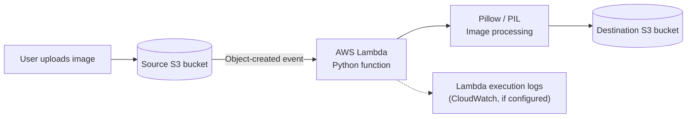

# 🖼️ AWS Image Resizer Automation

<p align="center">
  <strong>Automatically resize images uploaded to Amazon S3 using AWS Lambda, Python, and Pillow.</strong>
</p>

<p align="center">
  <a href="https://aws.amazon.com/s3/"></a>
  <a href="https://aws.amazon.com/lambda/"></a>
  <a href="https://www.python.org/"></a>
  <a href="https://pillow.readthedocs.io/"></a>
  <a href="https://developer.hashicorp.com/terraform"></a>
</p>

---

## 📌 Project Overview

This project automates image resizing with AWS services. When an image is uploaded to the **source S3 bucket**, an event triggers an **AWS Lambda function**. The function uses **Python** and the **Pillow (PIL) library** to process the image and stores the resized output in a separate **destination S3 bucket**.

The repository is organized into Lambda function code, a dependency layer, and Terraform infrastructure.

> **Project flow:** Upload image → S3 event → Lambda → Pillow resize → destination S3 bucket

---

## 🧭 Architecture



<details>
<summary><strong>🔍 How the architecture works</strong></summary>

1. **Upload:** An image is uploaded to the source S3 bucket.
2. **Trigger:** The S3 object-created event invokes the Lambda function.
3. **Read:** Lambda retrieves the uploaded image from the source bucket.
4. **Process:** Python code opens and resizes the image using Pillow.
5. **Output:** The processed image is written to the destination S3 bucket.
6. **Result:** The resized image is available separately from the original upload.

The source and destination buckets have different responsibilities: the source holds incoming images, while the destination stores the processed images.

</details>

---

## 🗂️ Repository Structure

```text
Image-Resizer-Automation/
│
├── lambda/       # Lambda function source code
│                # Reads uploaded images and performs resize workflow
│
├── layers/       # Lambda dependency layer
│                # Pillow / image-processing dependency packaging
│
├── terraform/     # Infrastructure as Code
│                # AWS resources and configuration
│
└── .gitignore    # Git exclusions
```

<details>
<summary><strong>📁 Explore each directory</strong></summary>

### `lambda/` — Function code

Contains the Python code used by the AWS Lambda function.

Responsibilities:
- Handle the S3 event notification.
- Identify the uploaded object.
- Retrieve the image from the source bucket.
- Use Pillow to resize the image.
- Upload the processed image to the destination bucket.

### `layers/` — Pillow dependency

Contains the dependency-layer setup for the Lambda function.

Why use a layer?
- Keeps third-party dependencies separate from function code.
- Allows Pillow to be included in the Lambda runtime.
- Helps package image-processing dependencies for the Lambda environment.

### `terraform/` — AWS infrastructure

Contains Terraform configuration for provisioning the project's AWS infrastructure.

The infrastructure supports the image-processing workflow, including the S3 buckets and Lambda-related configuration. Review the Terraform files in this folder for the exact resources, names, and settings used in your deployment.

</details>

---

## ⚙️ AWS Components

| Component | Role in this project |
|---|---|
| **Source S3 bucket** | Receives original image uploads and triggers the processing workflow. |
| **AWS Lambda** | Runs the Python function in response to the S3 upload event. |
| **Python** | Implements image-processing logic and AWS interaction. |
| **Pillow (PIL)** | Opens, resizes, and saves image data. |
| **Lambda Layer** | Packages Pillow and its dependencies for the Lambda runtime. |
| **Destination S3 bucket** | Stores the resized image output. |
| **Terraform** | Defines and provisions AWS infrastructure in code. |

---

## 🔄 Image Processing Workflow

<details open>
<summary><strong>Step-by-step execution</strong></summary>

### 1. Upload an image

Upload a supported image file to the source S3 bucket.

### 2. S3 event invokes Lambda

The bucket's object-created notification sends an event to the configured Lambda function.

### 3. Lambda reads the object

The function uses the event information to locate the image and retrieve it from S3.

### 4. Pillow processes the image

Pillow opens the image and applies the resize operation defined in the Python code.

### 5. Lambda writes the output

The function uploads the resized image to the destination S3 bucket.

### 6. Verify the result

Check the destination bucket for the generated image and confirm its dimensions.

</details>

---

## 🧰 Technology Stack

- **Amazon S3** — input and output object storage
- **AWS Lambda** — event-driven serverless execution
- **Python** — image-processing function logic
- **Pillow (PIL)** — image opening, resizing, and saving
- **AWS Lambda Layers** — dependency packaging
- **Terraform** — infrastructure provisioning

---

## 🚀 Deployment & Testing

> These commands describe a typical Terraform workflow. Use the resource names, variables, and packaging commands defined in your repository.

<details>
<summary><strong>1. Review the Terraform configuration</strong></summary>

```bash
cd terraform
```

Review the Terraform files and confirm the AWS region, bucket configuration, Lambda settings, and permissions match your environment.

</details>

<details>
<summary><strong>2. Initialize Terraform</strong></summary>

```bash
terraform init
```

</details>

<details>
<summary><strong>3. Validate and review infrastructure</strong></summary>

```bash
terraform validate
terraform plan
```

Inspect the plan before applying changes.

</details>

<details>
<summary><strong>4. Deploy the infrastructure</strong></summary>

```bash
terraform apply
```

Confirm the deployment when Terraform requests approval. Follow any project-specific packaging steps for the Lambda code and Pillow layer that are present in the repository.

</details>

<details>
<summary><strong>5. Test the image workflow</strong></summary>

1. Upload a test image to the source bucket.
2. Check the Lambda function's invocation and execution logs.
3. Verify that the resized image appears in the destination bucket.
4. Download the output and inspect its dimensions.

</details>

---

## 🧪 Troubleshooting Checklist

<details>
<summary><strong>Lambda does not run after upload</strong></summary>

- Verify the S3 event notification is configured for the source bucket.
- Confirm the event notification points to the intended Lambda function.
- Check Lambda invocation permissions.
- Review the function's CloudWatch logs for errors.

</details>

<details>
<summary><strong>Image processing fails</strong></summary>

- Confirm the uploaded object is a supported image.
- Verify the Pillow layer is compatible with the Lambda runtime and architecture.
- Check that the function imports Pillow successfully.
- Review the resize logic and temporary-file or in-memory handling in the Python code.

</details>

<details>
<summary><strong>Output is missing from destination bucket</strong></summary>

- Confirm the destination bucket name and key used by the function.
- Check the Lambda execution role's permissions to read from the source bucket and write to the destination bucket.
- Review the Lambda logs for S3 access or upload errors.
- Verify that the output object key does not unintentionally cause the function to retrigger itself.

</details>

---

## 🔐 Security Notes

- Use an IAM execution role with only the S3 permissions required by the function.
- Restrict source-bucket access to the intended upload workflow.
- Avoid storing AWS access keys in source code.
- Keep the source and destination buckets clearly separated.
- Review Terraform configuration before applying changes.

---

## 🎯 What This Project Demonstrates

- Building an event-driven AWS workflow with S3 and Lambda.
- Processing uploaded files with Python.
- Using Pillow for image resizing.
- Packaging Python dependencies with a Lambda layer.
- Separating original uploads from processed output.
- Managing AWS infrastructure with Terraform.

---

## 👨‍💻 Author

**Mohammed Armaan Bakshi**

- GitHub: [@Armaan-2005](https://github.com/Armaan-2005)

---

<p align="center">
  <em>Built to practice AWS serverless automation, Python image processing, and Infrastructure as Code.</em>
</p>
